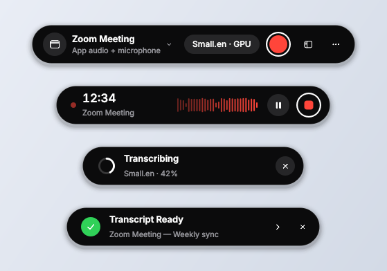
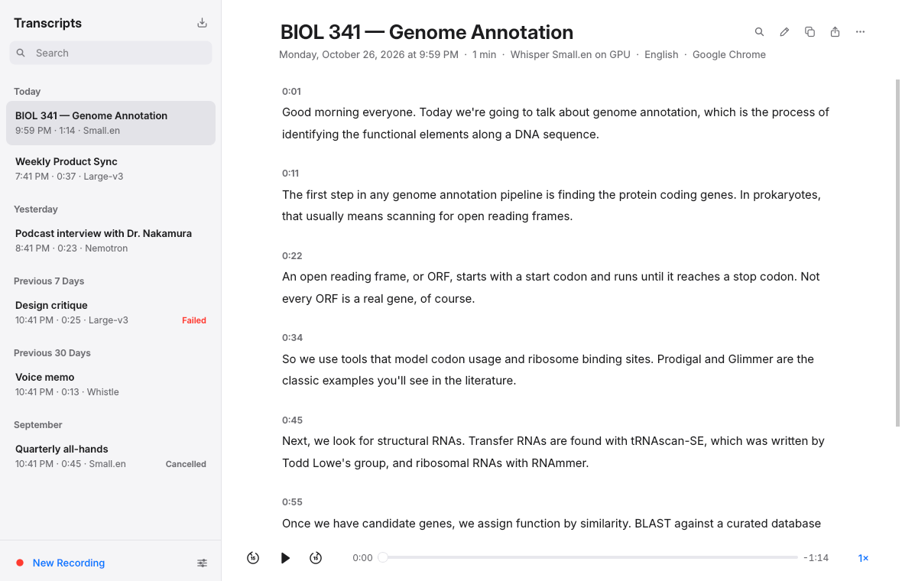
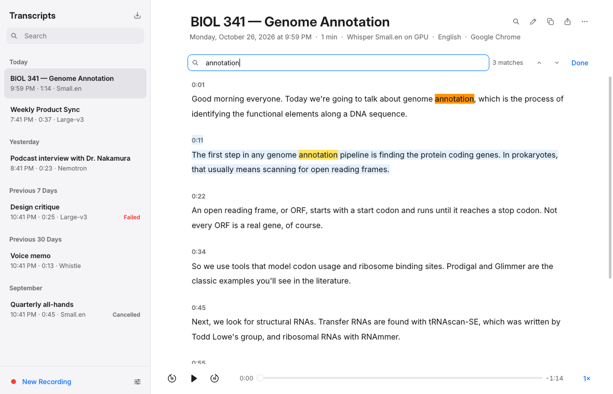
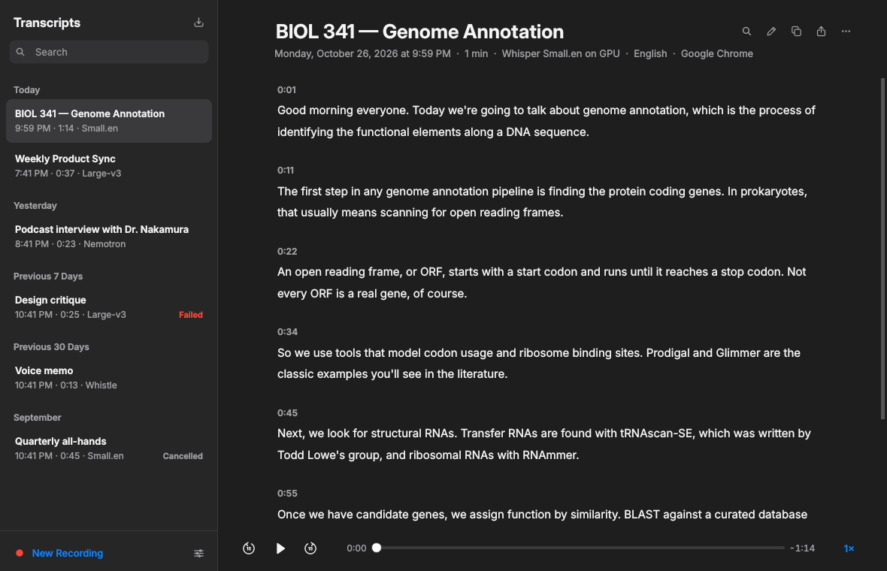
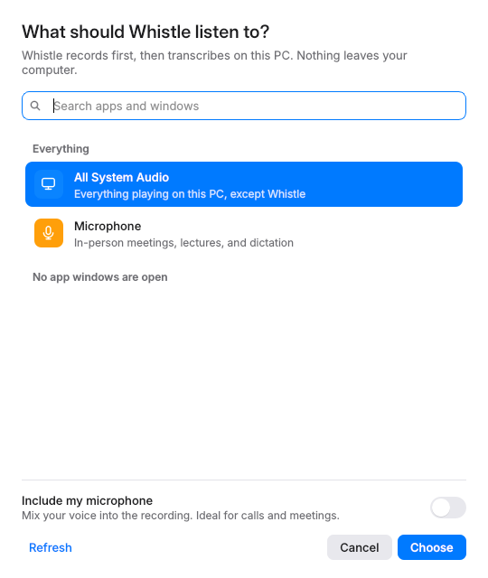
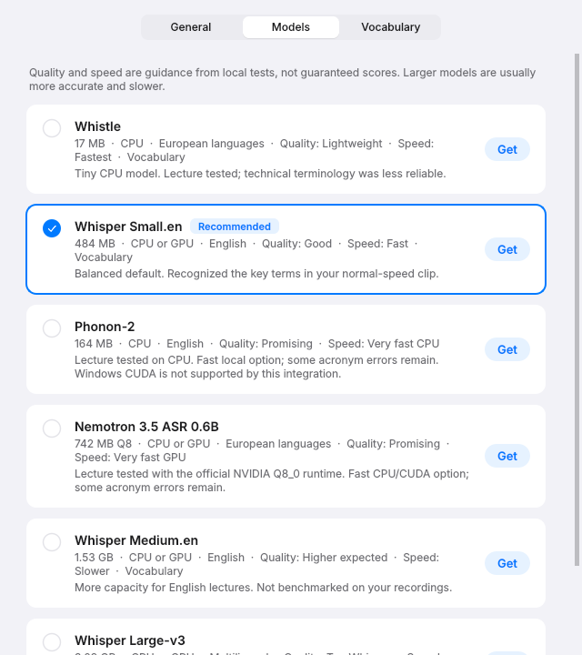

# Whistle

**Record anything you hear on your PC and get a searchable, playable transcript. Speech recognition runs locally on your PC.**

Whistle has two parts. The **pill** is a small capsule that floats above your windows; it starts and stops recordings. The **library** is where every transcript lives: you can search it, play it back, edit it, and export it.





## What it does

- **Record any source.** Choose one app (Zoom, Teams, a browser, a video player), **all system audio**, or **your microphone**. Turn on *Include my microphone* to mix your own voice into a call recording.
- **Record first, transcribe after.** Audio is saved to disk before any model runs, so a slow model never drops audio. You can pause and resume. A live waveform shows when the source is actually playing, and the pill says *Waiting for audio…* when it isn't. If the app you're recording closes, Whistle stops and transcribes what it captured.
- **Shortcut from anywhere.** **Ctrl+Alt+R** starts and stops recording. The tray icon offers the same controls.
- **Search the library.** Transcripts are grouped by date (Today, Yesterday, Previous 7 Days…) and search covers titles, apps, models and full text. **Ctrl+F** finds and highlights matches inside a transcript.
- **Click a timestamp to listen.** The player has ±15 s skips and 0.75×–2× speed, and the paragraph being spoken is highlighted as it plays.
- **Edit inline.** Fix names and typos, then press **Done**. Edits are stored next to the recognizer output, which is never overwritten. Click the title to rename a transcript.
- **Export or copy.** Formats are plain text, Markdown, SRT and WebVTT subtitles (timed per word where available), and JSON.
- **Import files.** Drag audio or video onto the library, or use **Import**. MP3, M4A, FLAC, OGG, Opus, WebM, MP4, MOV, MKV and WAV all work.
- **Import a video URL.** Click the globe beside Import, press **Ctrl+Shift+O**, or choose **Import Video URL…** from the pill or tray menu. Paste a YouTube link or another supported video/audio URL; Whistle downloads its audio and creates a normal saved transcript with your selected model, language, processor, and vocabulary. Downloading and transcription can be cancelled. One video is imported; playlist-only links use the first video.
- **Transcribe again with another model.** The new transcript reuses the same recording instead of copying it.
- **Add your vocabulary.** List names, jargon and acronyms in Settings › Vocabulary, and Whisper and Whistle models are nudged toward those spellings.
- **Light and dark.** The app follows Windows' theme automatically, matches the Windows 11 title bar, and uses its own vector icons and native-feeling controls.

| Find in transcript | Dark appearance |
|---|---|
|  |  |

| Choose a source | Models |
|---|---|
|  |  |

## Models and devices

Choose a model in **Settings › Models**, or switch quickly from the model chip on the pill. Models download once, on demand, and cancelled downloads resume.

| Model | Download | Device | Guidance |
|---|---:|---|---|
| Whistle | 17 MB | CPU | Smallest, fast; technical vocabulary was less reliable in lecture tests |
| Whisper Small.en | 484 MB | CPU / CUDA | Balanced English default; tested on lecture recordings |
| Phonon-2 | 164 MB compressed | CPU | Fast CPU candidate; lecture tested; acronym errors remain |
| Nemotron 3.5 ASR 0.6B | 742 MB Q8_0 + runtime | CPU / CUDA | Fast native NVIDIA runtime; lecture tested |
| Whisper Medium.en | 1.53 GB | CPU / CUDA | More English capacity; unbenchmarked here |
| Whisper Large-v3 | 3.09 GB | CPU / CUDA | Largest Whisper option, multilingual (incl. Japanese, Chinese, Korean, Portuguese); unbenchmarked here |

The quality and speed labels are guidance, not verified accuracy rankings. The model cards show local timings from one 56.14-second biology clip, which include worker startup and model loading. In that test Small.en was faster on CPU and Nemotron was faster on CUDA. There is no automatic GPU-to-CPU fallback: if the GPU isn't ready, Whistle asks before switching to the CPU.

Native Windows Phonon uses its official CPU engine; its published CUDA container is not integrated. Whistle is CPU-only. AMD/Vulkan/DirectML and Apple MLX are not offered. Audio never goes to an inference service, and package telemetry is disabled.

## Saved files

Each recording or import creates `transcripts/<date-and-time>/`:

- `Audio.wav`: the captured audio, written before inference. Imports are decoded to 16 kHz mono here. Re-transcriptions reference the original WAV in `session.json` instead of copying it.
- `Transcript.txt`: timestamped text, updated as sections finish and rewritten when you rename or edit.
- `segments.jsonl`: recognizer segments with word timestamps where available. Never modified after recording.
- `edits.json`: your edits, if any.
- `session.json`: title, source, model, device, status, duration, and inference timing. Cancelled or failed jobs are never marked complete. A session that was still running when Whistle closed shows as *Interrupted*, with a **Transcribe Again** button.
- `inference.log`: backend diagnostics.

Recordings stay until you delete them; deleting moves the folder to the Recycle Bin.

URL imports use [yt-dlp](https://github.com/yt-dlp/yt-dlp), which supports YouTube and many other video sites, plus direct audio/video links. Support depends on the site; private, paid, DRM-protected, login-required, and live videos may not work. Import a downloaded file when a site blocks access. YouTube extraction needs a supported JavaScript runtime: Whistle automatically enables installed **Node.js 22+** or **Deno 2.3+**, along with the solver scripts installed by `yt-dlp[default]`. No separate ffmpeg executable is needed for ordinary single-stream downloads; the existing audio decoder handles conversion. Site access uses your network connection; speech recognition remains local. Source URLs and video titles are stored in `session.json`, and the downloaded media is removed only after the session's `Audio.wav` is ready.

## Capture scope

- **One app** uses Windows process-loopback capture for the app's process and its children. Browsers can share a process tree across tabs and windows, so choosing Chrome can include other Chrome tabs; the source picker warns about this.
- **All system audio** captures everything except Whistle itself, so library playback is never recorded.
- **Microphone** uses the default input device. If Windows privacy settings block desktop apps from the microphone, Whistle names the setting to change.

Stalled sources (for example, an app that is silent) are filled with silence in real time, so timestamps match the wall clock and mixed streams stay aligned. Protected audio, and audio rendered by an unrelated service, may not be capturable.

## Setup

Requires x64 Windows build 20348+, Python 3.12, and Visual Studio or Build Tools with the *Desktop development with C++* workload.

```powershell
python -m venv .venv
.\.venv\Scripts\python.exe -m pip install -r requirements.txt
.\.venv\Scripts\python.exe scripts\setup_models.py
.\build-capture.cmd
.\.venv\Scripts\python.exe src\app.py
```

`build-capture.cmd` finds Visual Studio with `vswhere`, so you don't need to edit any paths. To launch, double-click **Launch Whistle.vbs** or **Launch Whistle.cmd**, or run `scripts/create-shortcut.ps1` to add desktop and Start-menu shortcuts (search **Whistle** in Windows). Both shortcuts point to this checkout. Launching a second time brings the running copy forward.

### Automatic updates

The launcher checks this repository's GitHub `main` branch on each full start and applies merged changes automatically. It uses your existing Git credentials, updates Python dependencies when `requirements.txt` changes, and rebuilds the capture helper when its source or build script changes. The first launch through the new updater prepares these once. A small progress window shows what is happening.

**Quit Whistle from its tray menu, then reopen it from Windows Search** to pick up a newly merged PR. Opening the shortcut while Whistle is already running just brings it forward; recording and transcription are not interrupted. Closing the library alone leaves Whistle running in the tray.

Updates require Git and the initial setup above. They apply only to a clean checkout of `main` with the expected GitHub origin and fast-forward history. Local edits, untracked source files, development branches, and local commits are preserved by skipping the update. Models, recordings, transcripts, settings, and the virtual environment are never replaced by Git updates. If GitHub cannot be reached, Whistle opens the installed copy. A failed dependency install or capture build shows an error and retries on the next launch; the prior capture executable is kept until a replacement builds successfully.

**Settings › General › Updates** shows the last result and opens `.updates/update.log`. Starting `src/app.py` directly bypasses the updater; after a manual pull, install changed requirements and rebuild the helper yourself.

Whisper on CUDA needs an NVIDIA driver, CUDA 12 cuBLAS, and cuDNN 9 DLLs. The isolated worker searches installed CUDA toolkits and PyTorch runtime DLL directories. Settings shows the GPU name and free VRAM, or what is missing. Before loading a model, inference checks free dedicated VRAM against a conservative reserve. GPU workers exit after each transcription to release memory. Nemotron uses official NeMo-Speech.cpp 0.2.0 Windows CPU/CUDA binaries, verified against the release SHA-256 checksums.

## Verification

Run the offline suite anywhere (Windows, Linux, CI); it needs no audio hardware, models, or GPU:

```powershell
.\.venv\Scripts\python.exe tests\offline.py
```

It drives the real recorder, worker protocol, library, settings, and app controller with stand-in capture helpers and a stand-in model. It covers mixing two streams, pause, cancellation, decoding compressed imports, re-transcription without copying, edits and every export format, preference rules, and live theme switching. CI runs it on Windows and Linux, and also compiles the native capture helper on Windows.

`tests/update_offline.py` uses real temporary local Git repositories to verify update application, retry behavior, and preservation of local work and app data. It uses stand-ins for dependency installation and compilation and needs no GitHub access.

These Windows checks need real hardware:

- `tests/integration.py --audio path/to/speech.wav`: real app audio → WAV → final pass → saved document.
- `tests/idle.py`: a silent app.
- `tests/isolation.py --audio path/to/speech.wav`: unrelated apps are excluded.
- `tests/models_integration.py --audio path/to/speech.wav`: six real model/device jobs; writes `test-output/benchmarks.json`. Updating the model picker timings requires explicit `--write-benchmarks`.
- `tests/job_failures.py --audio path/to/speech.wav`: decoder errors, cancellation, and native child cleanup (Nemotron CPU must be installed).
- `tests/ui_smoke.py`: live window list, app icons and names, and the real CUDA check.

These prove the tested paths ran and saved transcripts. They do not establish perfect transcription or a general quality leaderboard. Historical hardware evidence and its limits are in [docs/windows-validation.md](docs/windows-validation.md). Audio and comparison outputs are intentionally not distributed.

## Repository layout

```text
src/                 Application, UI, audio/model workers, updater
scripts/             Model setup and Windows shortcut installation
  evaluation/        Optional comparison tools (bring your own saved session)
native/              Windows process-loopback/system/microphone capture helper
tests/               Offline regression suite and opt-in hardware checks
docs/                Screenshots, architecture, validation and audit notes
.github/workflows/   Windows/Linux CI
```

The small root `app.py` and `launch.py` are compatibility entry points for existing shortcuts and older auto-updaters. Actual application code lives in `src/`. `Launch Whistle.vbs` and `.cmd` remain at the root so installed shortcuts continue working. The root build script stays compatible with existing updater staging.

Downloaded `models/`, generated `bin/`, saved `transcripts/`, `settings.json`, `.venv/`, and `.updates/` stay at the checkout root and are ignored by Git. Moving the source does not relocate your data. Paths are resolved from the source location, so launching from another working directory works.

See [architecture](docs/architecture.md), [contributing](CONTRIBUTING.md), and the [public-release audit](docs/public-release-audit.md).

## Sources and notices

[Whistle](https://huggingface.co/Cactus-Compute/whistle), [faster-whisper](https://github.com/SYSTRAN/faster-whisper), [Nemotron 3.5](https://huggingface.co/nvidia/nemotron-3.5-asr-streaming-0.6b), [NVIDIA native runtime](https://github.com/NVIDIA/NeMo-Speech.cpp), [Phonon-2](https://huggingface.co/FermionResearch/Phonon-2), [Phonon runtime](https://github.com/fermionresearch/phonon), [PyAV](https://github.com/PyAV-Org/PyAV), [Microsoft process-loopback documentation](https://learn.microsoft.com/en-us/samples/microsoft/windows-classic-samples/applicationloopbackaudio-sample/).

Phonon-2 derives from NVIDIA Parakeet TDT 0.6B v3; its weights are CC-BY-4.0 and its CLI/runtime is Apache-2.0. Notices are retained in downloaded packages. Nemotron model terms are linked from its card; its native runtime is Apache-2.0. Keep this folder in place so the desktop shortcut continues to work.

## License

Application code is licensed under [MIT](LICENSE). Downloaded models, native runtimes, and Python dependencies have their own licenses and are not relicensed by this repository. See [third-party notices](THIRD_PARTY_NOTICES.md) and [security information](SECURITY.md).
